# DonniesPool · Fantasy Hockey Pool Dashboard

**Who scored last night? Who’s in the money? Which draft pick is paying off?**

DonniesPool is an interactive fantasy hockey dashboard by Donnie McFarlane. Catch up on the pool in a few taps, then dig into the scoring runs, standings swings, and player performances behind the numbers. The dashboard works on phones and desktops.

**[Try the interactive demo](https://donnie-mcfarlane.github.io/fantasy-hockey-pool-dashboard/)**

The public demo uses contestant aliases and a scoring snapshot through November 19, 2026. The [dashboard for Bat’s Pool 2027](https://batspool2027-private.pages.dev/) uses Cloudflare Access with a one-time email passcode for approved participants.

[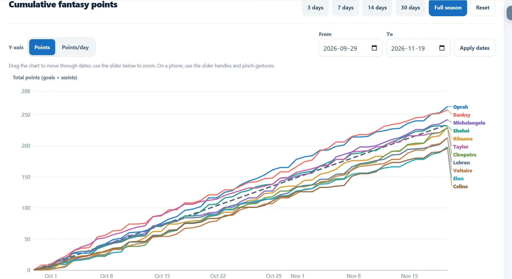](https://donnie-mcfarlane.github.io/fantasy-hockey-pool-dashboard/)

## Catch up in a few taps

- **Daily recap and tonight’s outlook.** See who led the pool in scoring last night, who climbed or fell in the standings, and how much of the season has elapsed. Open a contestant’s nightly scoresheet to see which NHL players supplied the points and who’s scheduled to play tonight.
- **Standings and prize race.** Check who holds the top three spots and see exactly how many points separate each contestant from the leader and from third place.
- **Daily puck board.** Coloured pucks show each contestant’s scoring by day. Up and down arrows mark the nights when the standings shifted.
- **Made for phones and desktops.** Use the jump menu to get straight to a section, tap contestant names to focus the charts, and pinch or slide to explore dates on mobile.

## Dig into the numbers

- **Interactive scoring trends.** Switch between cumulative points and points per day. Compare contestants against a 4.5-points-per-day benchmark, zoom in on a streak, or use the calendar to compare any stretch of the season.
- **Points and position changes over the same dates.** See who scored the most in your chosen window and who actually gained ground in the standings.
- **Player leaderboard and draft comparisons.** Sort by season points, last night, the last seven days, or how far a player is above their draft-round average. Filter by contestant, position, draft round, or availability. Expand a player for the scoring breakdown.
- **Daily refresh for the active pool.** The workflow is scheduled to import completed NHL scoring and publish the updated dashboard each morning.

## Desktop and mobile screenshots

Expand a feature to compare views. Select an image to see it at full size.

Daily recap and nightly scoresheet

| Desktop | Mobile |
| --- | --- |
| [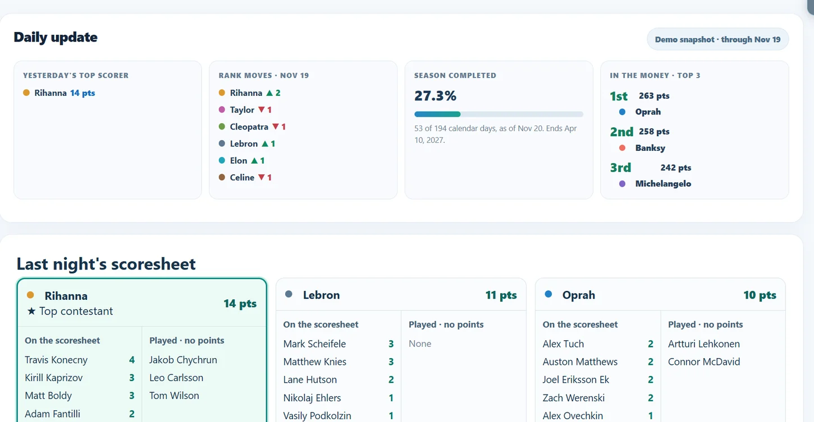](docs/screenshots/daily-recap-desktop.webp) | [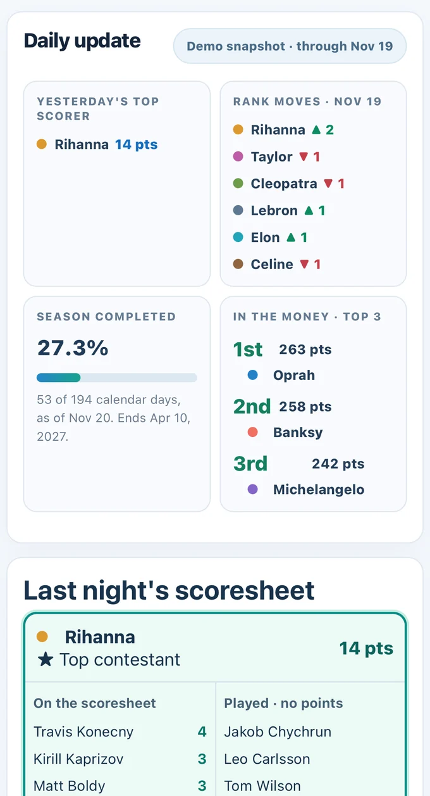](docs/screenshots/daily-recap-mobile.webp) |

Standings and prize race

| Desktop | Mobile |
| --- | --- |
| [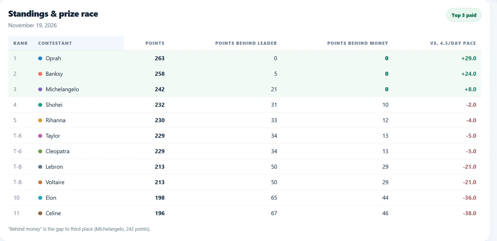](docs/screenshots/prize-race-desktop.webp) | [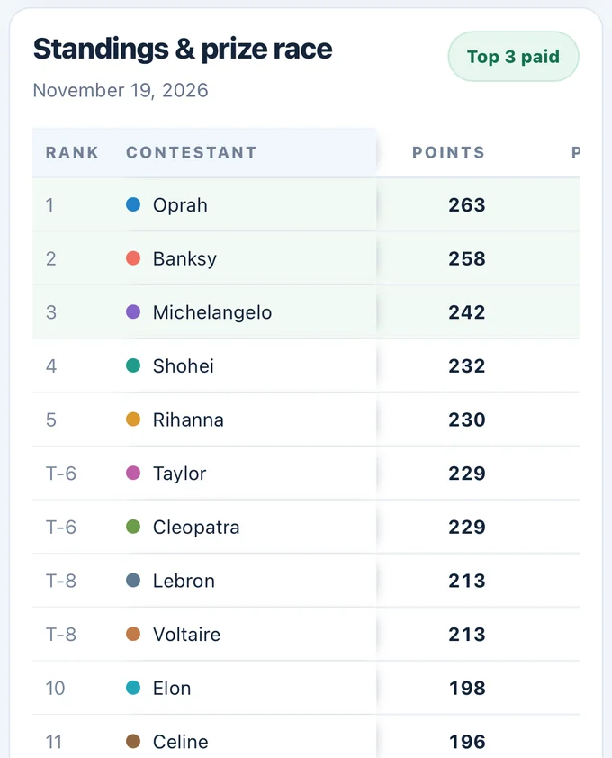](docs/screenshots/prize-race-mobile.webp) |

Daily puck board

| Desktop | Mobile |
| --- | --- |
| [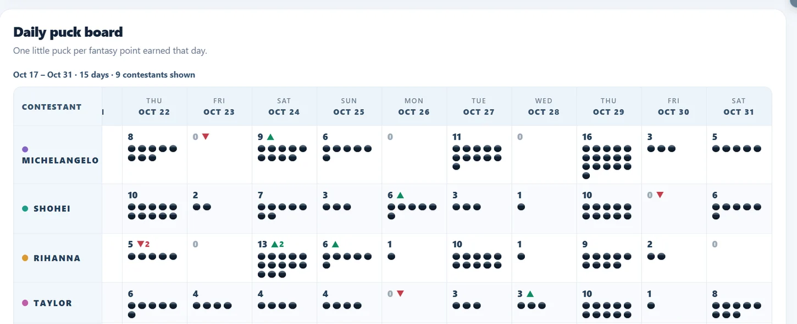](docs/screenshots/puck-board-desktop.webp) | [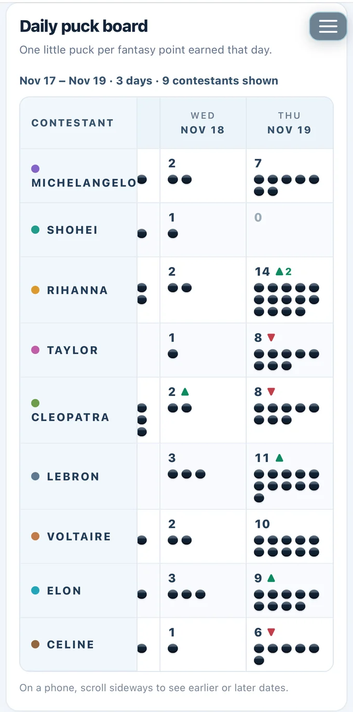](docs/screenshots/puck-board-mobile.webp) |

Season scoring pace

| Desktop | Mobile |
| --- | --- |
| [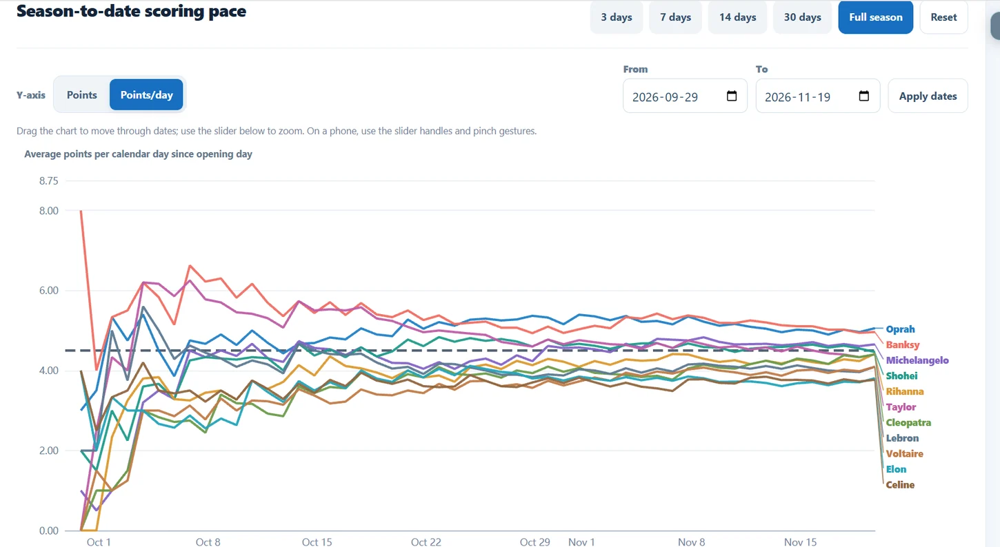](docs/screenshots/scoring-pace-desktop.webp) | [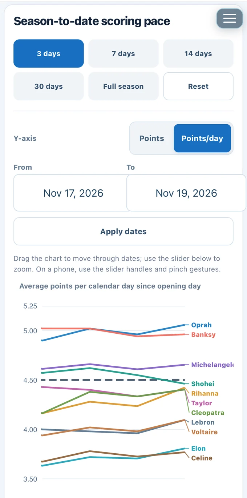](docs/screenshots/scoring-pace-mobile.webp) |

Position changes

| Desktop | Mobile |
| --- | --- |
| [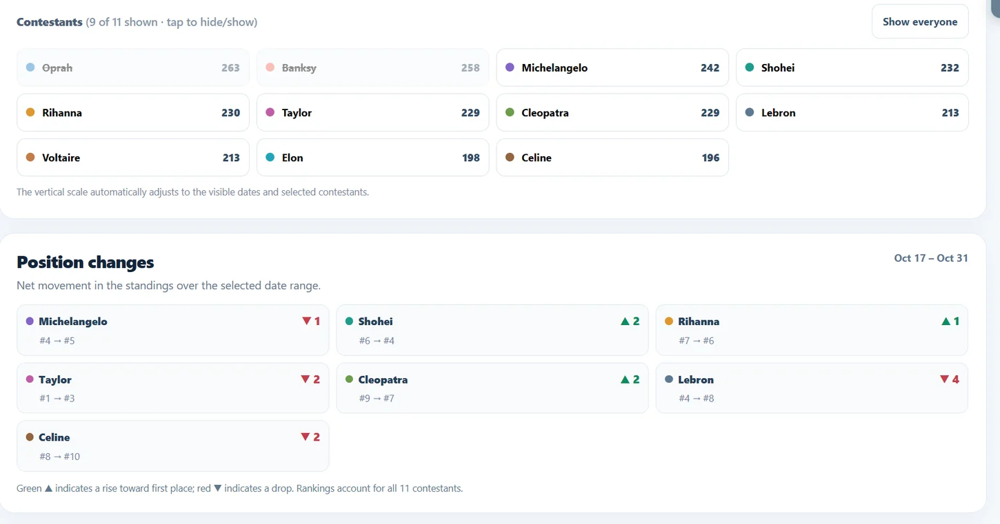](docs/screenshots/position-changes-desktop.webp) | [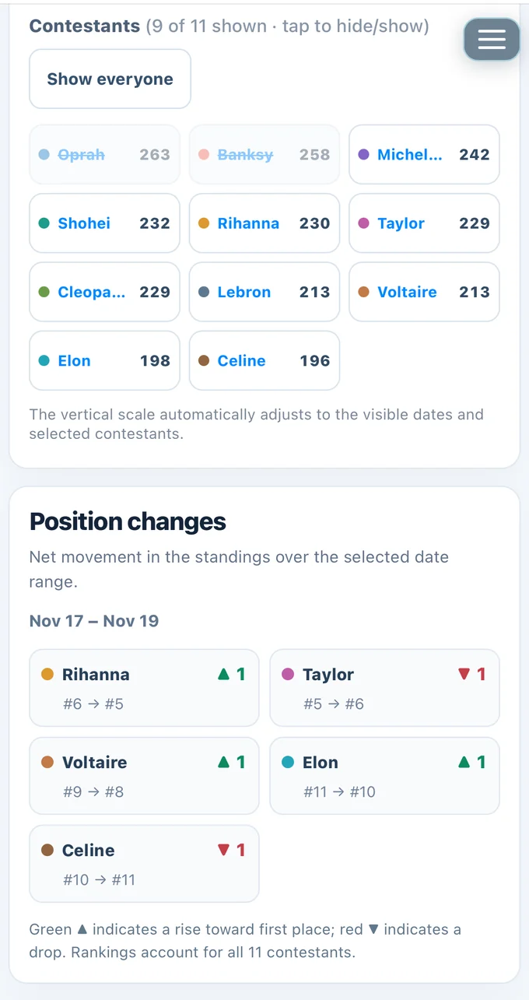](docs/screenshots/position-changes-mobile.webp) |

Scoring in a selected date range

| Desktop | Mobile |
| --- | --- |
| [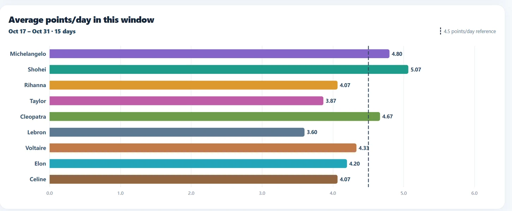](docs/screenshots/date-window-desktop.webp) | [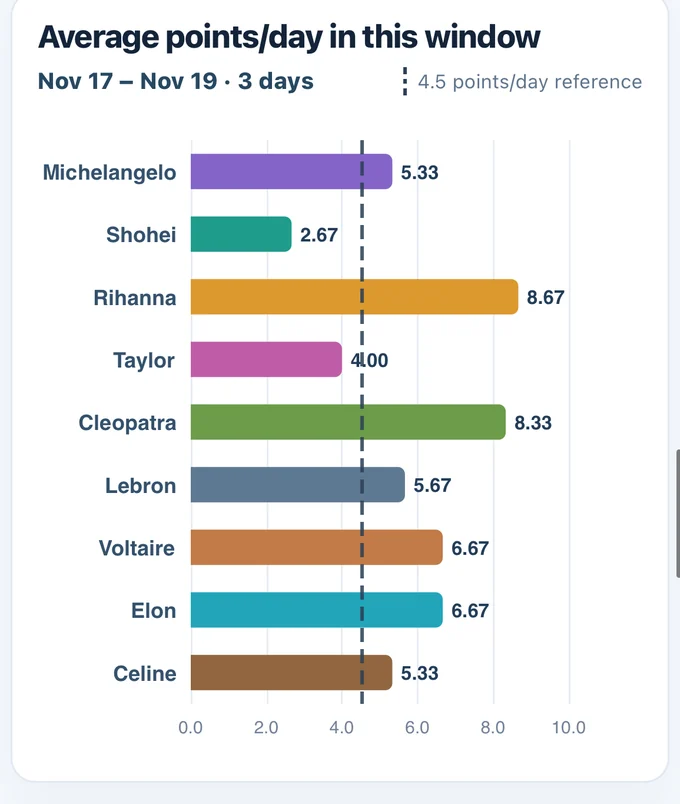](docs/screenshots/date-window-mobile.webp) |

Player leaderboard

| Desktop | Mobile |
| --- | --- |
| [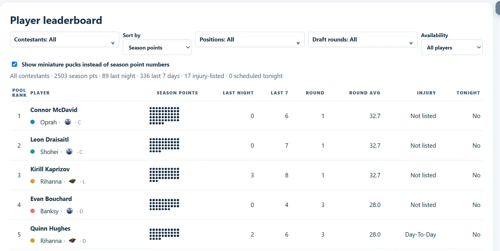](docs/screenshots/player-leaderboard-desktop.webp) | [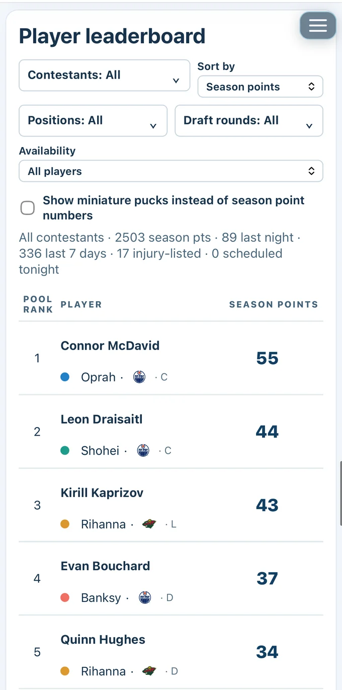](docs/screenshots/player-leaderboard-mobile.webp) |

Mobile jump menu

<a href="docs/screenshots/jump-menu-mobile.webp">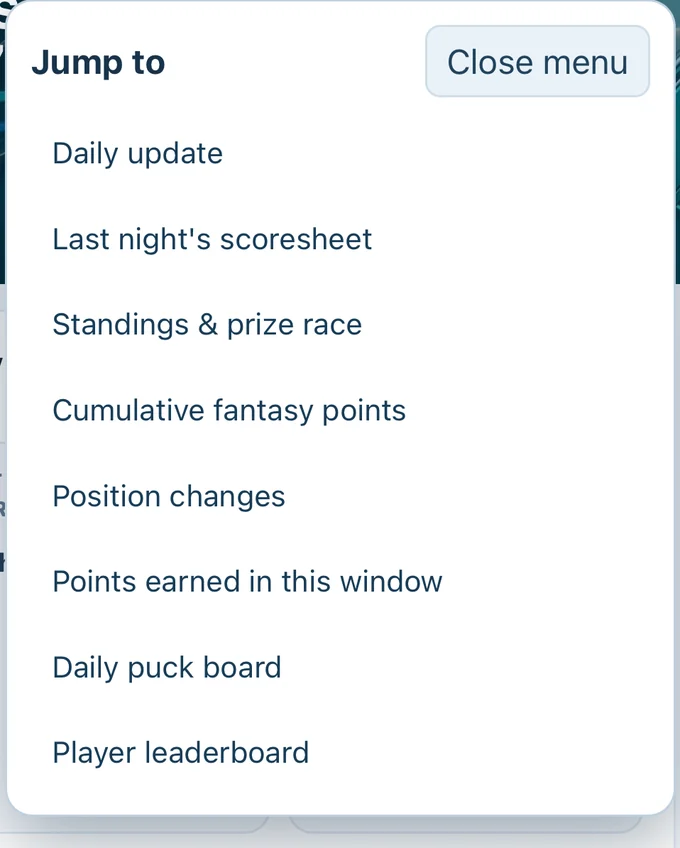</a>

## Personal use and permissions

DonniesPool was created by **Donnie McFarlane** and is **free for personal use**. Any other use or any adaptation requires Donnie McFarlane’s prior consent.

I’m happy to discuss setting up custom fantasy sports pools for others. [Get in touch on GitHub](https://github.com/Donnie-McFarlane).

## Build the demo locally

Run `python3 render_chart.py --output _site` and open `_site/index.html`.

Live deployment setup

Both builds use the same template and renderer. The live workflow refreshes NHL scoring and deploys to the existing Cloudflare Pages project behind Access. Real contestant names are applied during the live render.

Create a GitHub Actions environment named `live`, restricted to the default branch, and add these environment secrets.

- `CONTESTANT_NAMES` maps `pool-01` through `pool-11` to display names in the fixed order of contestants in `data/demo.json`.
- `CLOUDFLARE_API_TOKEN` needs Cloudflare Pages Edit and Access Applications and Policies Read permissions for the account that owns the Pages project.
- `CLOUDFLARE_ACCOUNT_ID` identifies that Cloudflare account.
- `LIVE_STATE_KEY` is a randomly generated encryption passphrase for the scoring checkpoint in the `live-state` branch. Keep a private backup.

Run **Refresh private DonniesPool dashboard** manually to verify the first deployment. Set the repository Actions variable `LIVE_ENABLED` to `true` to enable the 3:00 a.m. Toronto run and the 5:15 a.m. retry.

